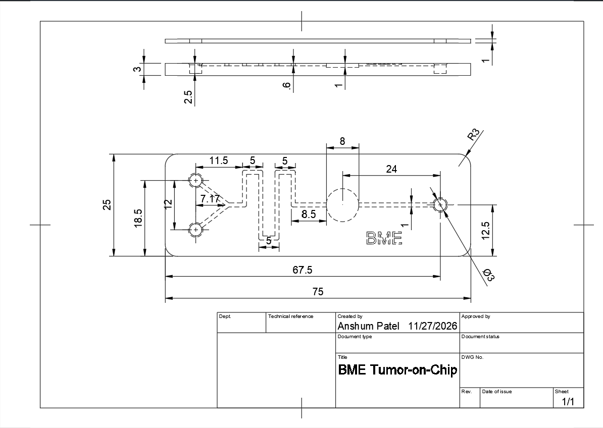

Standard well-plate culture is static: cells sit in fixed media with no flow. Tumors in the body are perfused, so nutrient, oxygen, and drug exposure all depend on flow. This chip is designed to bring that flow into a small, imageable culture platform for studying the tumor microenvironment.

## Design

The device is two parts: a channel plate and a thin lid that seals the channels. Fluid enters through two inlets that merge into one channel, passes through a serpentine section that mixes the streams, then reaches a central culture chamber where the cells sit under flow. A single outlet carries effluent away.

The lid carries the port holes, one for each inlet and one for the outlet. Chamfered ports are intended to support leak-resistant tubing connections.

## Specifications

- Chip: 75 x 25 x 3 mm with 3 mm corner radii, plus a 1 mm lid
- Channels: 1 mm wide, 0.6 mm deep
- Culture chamber: 8 mm diameter
- Ports: 3 mm diameter, 2.5 mm deep

## What it is intended for

The layout is built to support controlled perfusion of cancer cells in one defined chamber. That setup is intended for studying drug response, nutrient and oxygen gradients, and cell-cell interactions under flow, which a static well plate cannot do.

## Parametric model

The model is driven by one parameter set in Fusion 360. Channel, chamber, and port dimensions can be changed in one place and the geometry updates with them.

## Status

Design only. The chip has not been fabricated or tested, so no flow or cell results are claimed here.
